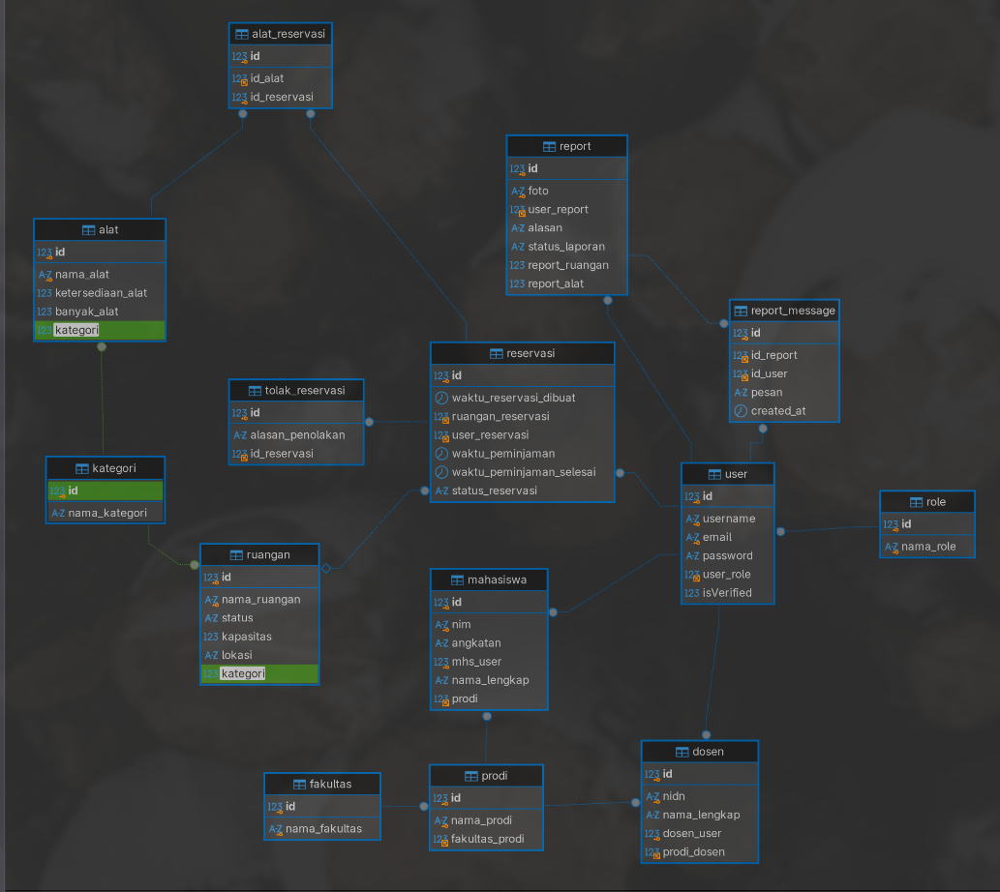

# SiPinjam - Sistem Reservasi & Pelaporan Fasilitas Kampus

Repositori Tugas Besar Pemrograman Platform Khusus (PPK) Semester 5.

Aplikasi web untuk manajemen peminjaman fasilitas kampus (ruang kelas, aula, laboratorium, alat, dan lapangan) serta penanganan laporan kerusakan fasilitas. Alur pemesanan dan pelaporan sarana diproses bersamaan oleh petugas dan admin dalam satu sistem.

---

## Ketentuan dan Aturan Sistem

Beberapa aturan utama yang diterapkan di aplikasi ini:

1. **Jam Operasional**: Fasilitas hanya bisa dipesan antara jam 07.00 sampai 20.00 WIB.
2. **Slot Waktu 30 Menit**: Durasi pemesanan memakai kelipatan slot 30 menit (contoh: 07.00-07.30, 07.30-08.00). Validasi slot dan jam operasional dicek langsung di server backend (bukan cuma di tampilan kalender).
3. **Batas Pengajuan**: Pengajuan reservasi paling cepat diajukan H-2 (minimal 2 hari sebelum kegiatan).
4. **Pembatalan Mandiri**: Peminjam bisa membatalkan reservasi sendiri paling lambat 2 jam sebelum jadwal mulai. Lewat dari itu, pembatalan harus lewat petugas/admin (kondisi darurat).
5. **Cek Bentrok**: Jadwal yang sudah disetujui otomatis mengunci slot fasilitas agar tidak bentrok. Fasilitas yang sedang berstatus perbaikan juga tidak bisa dipesan.
6. **Laporan Kerusakan**: Pengguna bisa melampirkan foto bukti (format JPG/PNG, ukuran file maksimal 2MB).

---

## Pembagian Role

- **Pengunjung (tanpa login)**:
  - Melihat daftar fasilitas dan mengecek ketersediaan jadwal slot 30 menit tanpa melihat nama peminjam maupun alasan peminjaman.
- **Pengguna (Mahasiswa / Dosen / Staf)**:
  - Mengajukan reservasi ruangan atau alat dan mengisi tujuan peminjaman.
  - Membatalkan reservasi milik sendiri (sebelum batas 2 jam).
  - Melihat riwayat status reservasi yang diajukan.
  - Melaporkan fasilitas yang rusak dengan upload foto kendala.
  - Memantau status laporan kerusakan.
- **Petugas**:
  - Melihat dashboard antrean reservasi dan laporan masuk.
  - Menerima (approve) atau menolak reservasi dengan pengecekan bentrok jadwal otomatis.
  - Membatalkan reservasi yang sudah disetujui jika ada kondisi mendesak dengan mencantumkan alasan.
  - Mengubah status penanganan laporan (baru, diproses, selesai, ditolak) dan mengisi catatan perbaikan.
  - Mengubah status fasilitas menjadi perbaikan saat ada kendala dan mengembalikannya ke status aktif setelah selesai diperbaiki.
- **Admin**:
  - Kelola data master fasilitas (tambah, edit, nonaktifkan, hapus ruangan & alat).
  - Menambahkan akun petugas langsung (petugas tidak bisa registrasi sendiri).
  - Menambahkan akun pengguna langsung.
  - Verifikasi atau tolak akun pengguna baru yang mendaftar lewat form registrasi mandiri.
  - Melihat dan ekspor data rekapitulasi okupansi dan frekuensi kerusakan (format Excel, CSV, PDF).

---

## Tech Stack

- **Backend**: Golang (net/http, driver MySQL)
- **Frontend**: Next.js 16 (App Router), TypeScript, Vanilla CSS
- **Database**: MySQL / MariaDB

---

## Foto Database




## Struktur Folder

```text
sipinjam/
|-- backend/
|   |-- config/          # Pengaturan database
|   |-- controller/      # Handler endpoint API
|   |-- database/        # File skema database (db_schema.sql)
|   |-- middleware/      # Cek auth session & role
|   |-- models/          # Struct data
|   |-- repositories/    # Query ke database
|   |-- routes/          # Pengaturan route API
|   |-- services/        # Logika validasi dan bisnis
|   `-- uploads/         # Folder simpan file foto laporan
|-- frontend/
|   |-- app/             # Halaman frontend (App Router)
|   |-- components/      # Komponen tampilan UI
|   |-- context/         # State management data aplikasi
|   |-- lib/             # Fetch API & utilitas slot jadwal
|   `-- models/          # Type definition TypeScript
|-- api-design.md        # Catatan desain endpoint API
|-- db.png               # ERD database
`-- README.md
```

---

## Cara Menjalankan Projek

### 1. Database

1. Buat database baru di MySQL/MariaDB (misal: `tubes_ppk_web`).
2. Import file database dari `backend/database/db_schema.sql`.

### 2. Backend (Golang)

1. Masuk ke direktori backend:
   ```bash
   cd backend
   ```
2. Siapkan file konfigurasi lingkungan `.env` (bisa salin dari `example.env` pada root projek), lalu sesuaikan akun koneksi database lokal masing-masing.
3. Jalankan server:
   ```bash
   go run .
   ```
   Backend akan berjalan di port `8080`.

### 3. Frontend (Next.js)

1. Buka terminal baru dan masuk ke direktori frontend:
   ```bash
   cd frontend
   ```
2. Pasang package dependensi:
   ```bash
   npm install
   ```
3. Jalankan development server:
   ```bash
   npm run dev
   ```
4. Buka di browser: `http://localhost:3000`.

---

## Akun untuk Uji Coba

Untuk keperluan testing fitur per role, bisa gunakan akun berikut:

| Role | Email | Password | Akses Halaman |
| :--- | :--- | :--- | :--- |
| Admin | galvindoser@gmail.com | Test@123 | /admin |
| Petugas | petugas@sipinjam.ac.id | Petugas@123 | /petugas |
| Mahasiswa | galvin@gmail.com | Lol@123 | /pengguna |
| Dosen | dosen@sipinjam.ac.id | Dosen@123 | /pengguna |
| Staf | staf@sipinjam.ac.id | Staf@123 | /pengguna |

Akun pengguna baru juga bisa dicoba lewat menu registrasi (`/register`), lalu approve akun tersebut lewat login akun Admin pada menu Verifikasi Akun.